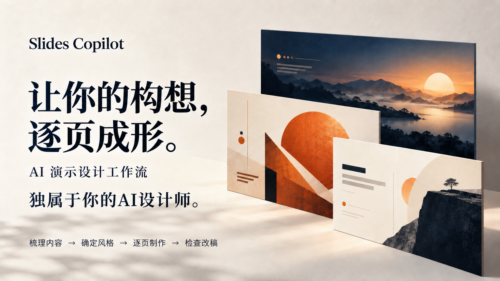

<h1 align="center">Slides Copilot——独属于你的 AI PPT 设计师</h1>

<strong>Your Vision, Slide by Slide</strong>

  

  <strong>含多技能与视觉知识库的 AI 演示设计工作流包。</strong>

  <a href="#showcase">设计示例</a> &nbsp;·&nbsp;
  <a href="#quick-start">开始使用</a> &nbsp;·&nbsp;
  <a href="#your-style">添加参考</a> &nbsp;·&nbsp;
  <a href="#make-it-yours">反馈与贡献</a>

  3 个技能 &nbsp; / &nbsp; 20 组视觉说明 &nbsp; / &nbsp; 28 张教学图片

---

## 项目工作流程

你可以像和设计师对接一样使用它：说明需求、讨论方案、看样稿、提修改意见。Agent 会主动询问关键信息，给出设计建议，并根据你的反馈调整。

| 1. 内容整理 | 2. 视觉设计 | 3. 制作与修改 |
| :--- | :--- | :--- |
| 阅读你的材料，与你确认用途、受众和表达重点，梳理内容与分页。 | 结合参考图和你的偏好，提出配色与排版建议，与你商量设计方向。 | 先做样稿供你确认，再完成其余页面。你可以针对具体页面提出意见，继续修改。 |

## 设计示例

三组示例，每组包含封面和内容页。点击图片查看原图。

<table>
  <tr>
    <th width="50%">封面</th>
    <th width="50%">内容页</th>
  </tr>
  <tr>
    <td colspan="2"><strong>01 · 山野咖啡</strong> &nbsp; 暖棕色 / 品牌介绍</td>
  </tr>
  <tr>
    <td></td>
    <td></td>
  </tr>
  <tr>
    <td colspan="2"><strong>02 · 灵感实验室</strong> &nbsp; 深色科技 / 产品介绍</td>
  </tr>
  <tr>
    <td></td>
    <td></td>
  </tr>
  <tr>
    <td colspan="2"><strong>03 · 城市漫游</strong> &nbsp; 清爽绿色 / 生活提案</td>
  </tr>
  <tr>
    <td></td>
    <td></td>
  </tr>
</table>

## 开始使用

**使用环境：**支持本地文件读取、图片查看和生图的 Codex 环境。

1. **下载项目**：点击仓库的 `Code → Download ZIP`，解压并保留完整目录，包括隐藏的 `.agents/`。
2. **打开文件夹**：在 Codex 中打开项目目录，提供你的材料、用途和设计要求。
3. **与 Agent 沟通**：把它当作设计师，直接说你的想法，提供现有材料。需求不必一次说全，Agent 会先读材料，询问必要的信息，再与你讨论方案、看样稿、改设计。

例如：“我下周要向客户介绍这款产品，这是现有资料。你先看看，帮我想想怎么讲、怎么呈现。”

修改示例：“保留配色，第二页文字太挤，请重新排版。”

> 输出为整页图片，文字无法像 PPT 文本框一样直接编辑。生图需要当前环境提供相应工具。

## 添加设计参考

将你喜欢的 PPT 页面截图或导出图片放入 `design-library/images/` 即可。Agent 会在设计时主动查看，结合当前内容分析适合借鉴的配色、页面填充程度和视觉气质，不需要你逐张说明。已有作品沿用已确认的设计方向；没有参考图时，Agent 会根据需求提出设计建议。

出于版权考虑，仓库不附带第三方 PPT 风格参考图，需要自行补充。请使用有相应授权的素材；上传公开仓库前，确认允许公开分发。

## 反馈与贡献

问题反馈和作品分享请提交 Issue，修改建议可以提交 PR。欢迎 Star 收藏，或 Fork 后自行修改。

---

代码和文档采用 [MIT 许可证](LICENSE)。
