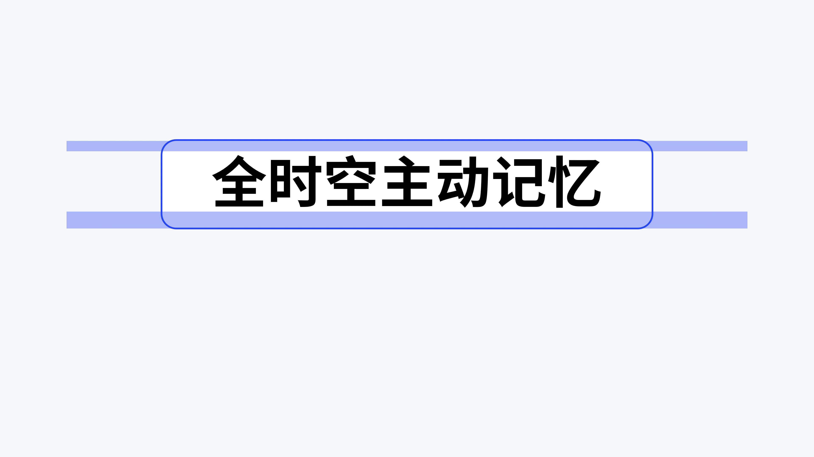
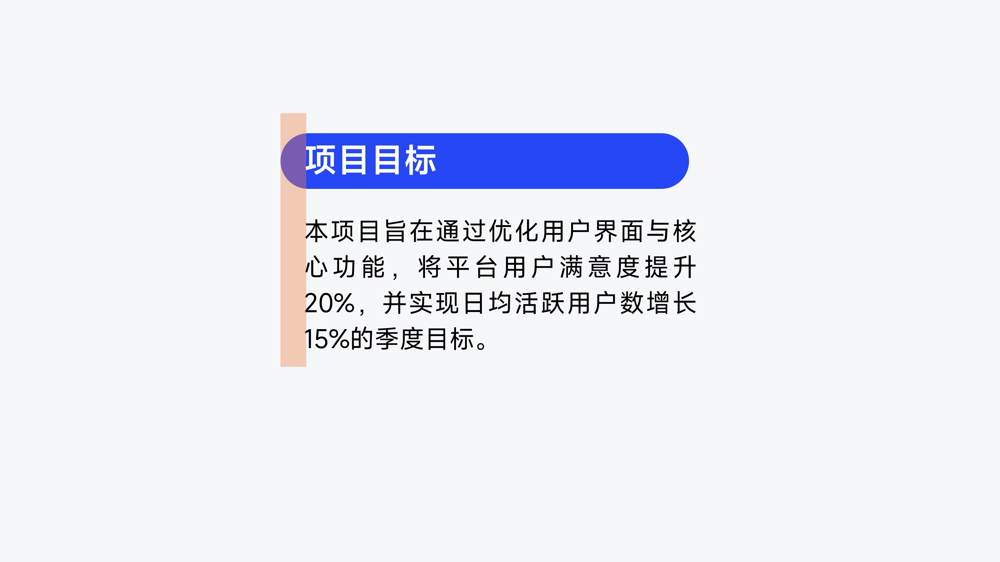

# V01 · 对齐的是可见字形

关键词：视觉对齐、光学对齐、文本框、字形、边距。

看第一张：蓝色外框及上下色带对应的边界，与黑色字形真正占据的范围不同。仅把外框居中，并不能保证视觉上已经居中。

看第二张：橙色竖带帮助比较标题色块、标题文字与正文的左缘。圆角端部、字形空白和正文边缘共同影响感受，应检查实际看见的文字关系。

应用于标签、按钮式小标题、正文和大标题的对齐。生成后若看起来偏移，应以可见笔画为依据微调。提示词可以写：“标题与正文的可见字形左缘形成稳定对齐；标题色块在文字周围自然延伸。”不要从图里推导所有字体通用的固定偏移数值。

方法：[构图与排版](../handbook/layout.md)。
