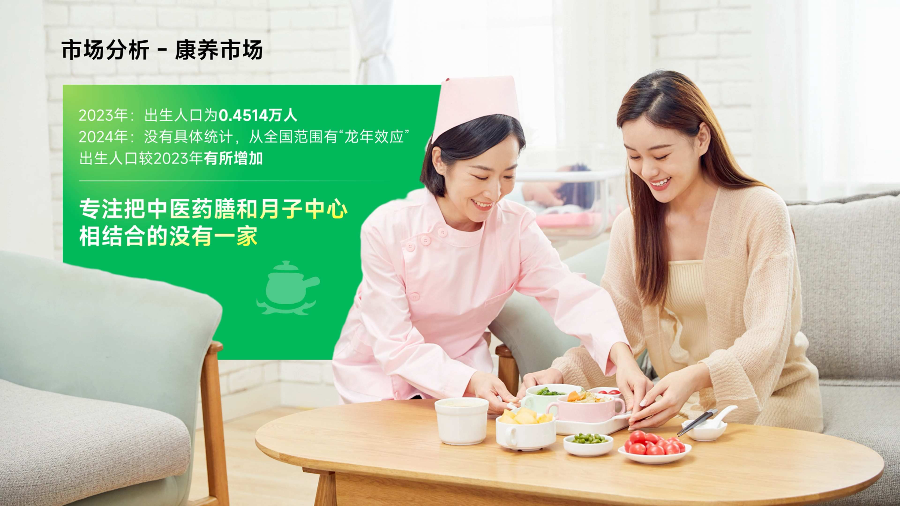

# V02 · 图文共用一个空间

关键词：图文融合、共享空间、人物、信息底板、填充度。

看左侧绿色信息区与右侧人物：人物位于信息底板之前，桌面和室内环境贯穿画面。文字有承载区，照片仍然构成整个页面的场景，视觉不会在一块文字和一张独立照片之间断开。

此图适合解释怎样让内容充实而不零散。绿色块的边界、人物前后关系和正文区域共同建立整体，并非单纯把照片铺满。

应用时先找到图中能容纳信息的区域，再设计明暗和遮挡。提示词可写：“人物作为前景，信息区与环境共用画面；人物自然压住底板边缘，文字保持完整可读。”实际遮挡关系要服务内容，不能挡住证据和关键文字。

方法：[参考与填充度](../handbook/reference.md)、[构图与排版](../handbook/layout.md)。
