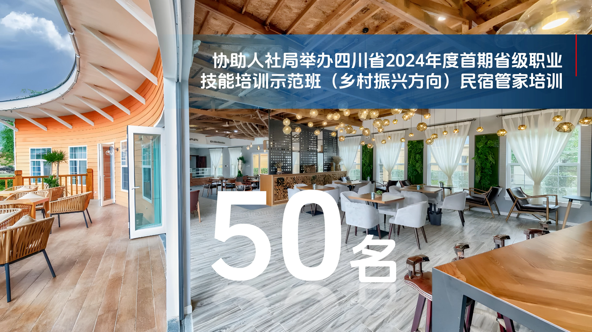
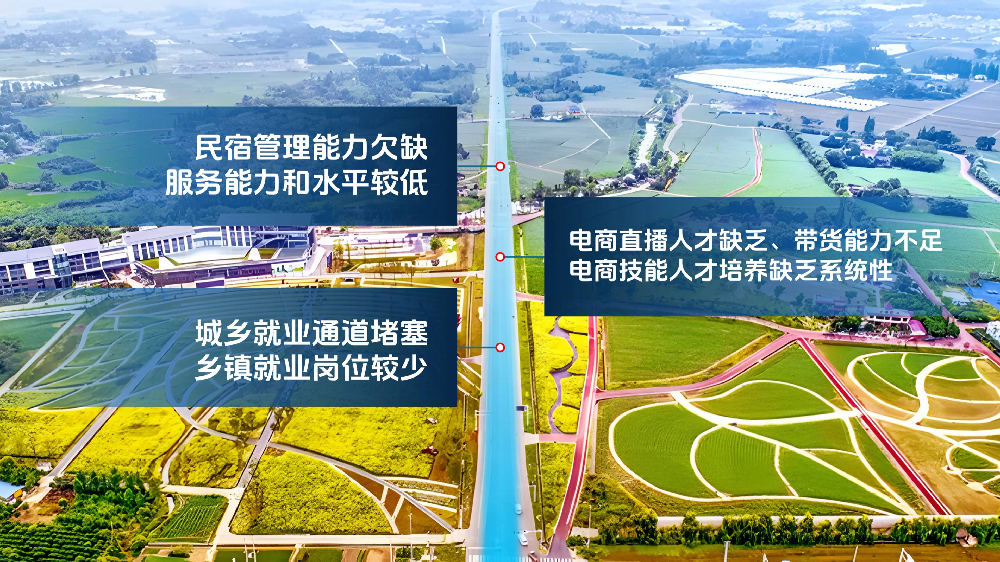

# V03 · 沿着场景组织信息

关键词：场景排版、道路、空间线索、数字、因图制宜。

第一张的关键数字位于室内相对开阔的下部，借地面与空间纵深获得体量；标题利用上部横向区域。第二张用贯穿画面的道路作为组织轴，信息分列两侧，位置呼应各自的场景区域。

共同方法是先读出图片的结构，再决定文字位置。遇到建筑、道路、产品轮廓、人物视线或自然地形时，都可以寻找已有的组织线索。每张图片提供的线索不同，布局也随之变化。

提示词可写：“以道路为视觉轴，三组信息沿两侧错落展开，保持内容顺序和文字清晰；让场景引导分组。”需要空间化数字时另行说明其姿态和接触关系，不能为了透视效果降低可读性。

方法：[构图与排版](../handbook/layout.md)。
