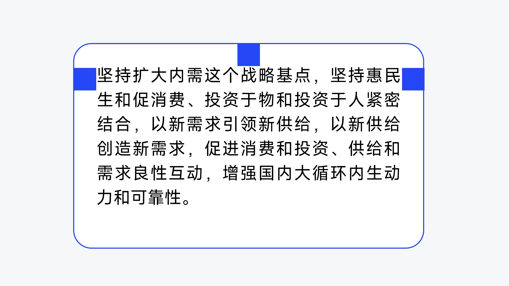

# V05 · 容器要给内容留出内边距

关键词：容器、内边距、卡片、正文、呼吸感。

看顶部与左右的蓝色方块：它们把正文与容器边界之间的空间变成可比较的单位。文字如果贴住边线，会显得局促；如果边距过大，又会挤压文字容量。

内边距应围绕字形、容器尺度和信息密度判断。同一层级容器要有稳定的边距节奏，内容量不同则需要重新分配容器体量，而不是盲目缩小文字。

提示词可写：“正文四周有稳定而紧凑的内边距，文字不贴边；容器大小适应实际行数。”图中标尺是观察方法，并非要求所有项目使用相同字宽作边距。

方法：[构图与排版](../handbook/layout.md)。
