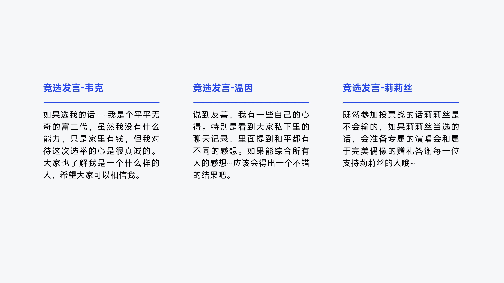
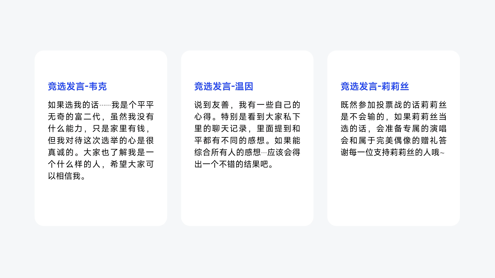

# V06 · 线与面带来不同分组力度

关键词：分隔线、底板、卡片、线面、信息分组。

同样三组信息，第一张用细线划出标题与正文的关系，视觉较轻；第二张用白色圆角面把各组包在一起，边界更强，也增加了页面中可见块面的体量。

选择取决于当前分组是否容易识别、背景是否复杂，以及用户希望页面排得多满。已有清楚分组时增加容器可能多余；复杂底图上的长文字可能需要更明确的承载面。

提示词分别可以写：“用细线和间距分组，保持轻盈”或“用统一材质的底板聚合信息，容器之间留出清楚间隔”。不要把所有内容自动变成等大的三张卡片。

方法：[构图与排版](../handbook/layout.md)。
