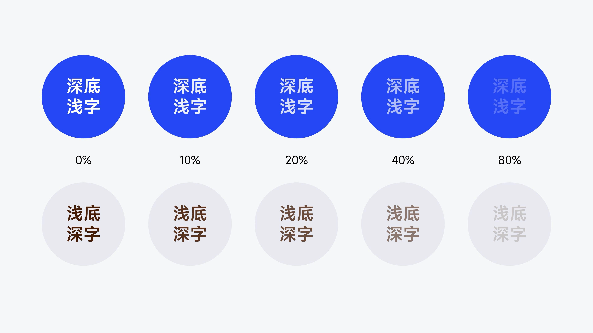

# V07 · 文字淡下去，层级也可能消失

关键词：可读性、对比度、文字透明度、深底浅字、浅底深字。

上排为深色底上的浅字，下排为浅色底上的深字。从左往右文字逐渐变淡；越接近背景，越难辨认。两种背景都需要保留足够的亮度差。

次要文字可以降级，但降级之后仍要完成阅读任务。页面正常观看尺寸、实际屏幕和背景细节都会影响结果，不能把图中百分比当作通用阈值。

提示词可写：“正文与承载区保持清楚的明暗差；辅助说明低于标题层级，但在实际展示尺寸下仍可直接读清。”当字难读时，先看明暗、尺寸和底图干扰，再考虑其他装饰。

方法：[配色与文字](../handbook/color-type.md)。
