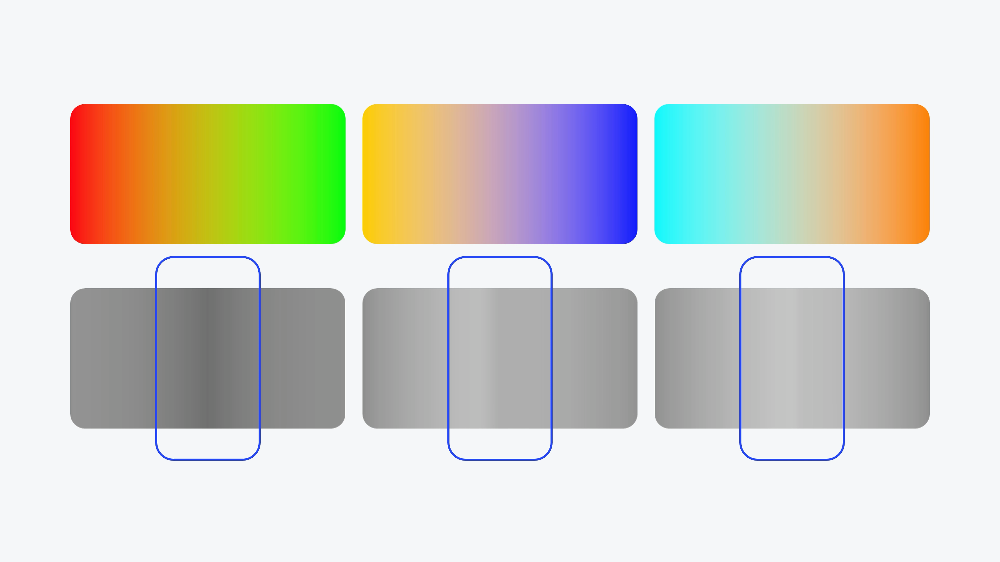

# V08 · 看渐变的中间发生了什么

关键词：渐变、中间色、灰度、发灰、发脏、亮度。

上排是不同颜色之间的渐变，下排把明暗关系单独呈现。描边标出的中段帮助观察：两个端点都鲜明，连接区域却可能出现不想要的明度变化或灰感。

判断渐变时，不只看起止颜色，也看中间的色相、饱和度和明暗走向。若目标是通透的光感，中段的脏灰常会破坏效果；若目标是暗调材质，局部降低亮度可能恰好合适。

提示词可写：“过渡保持目标色系，中段干净、明暗连续，没有突兀的灰暗带。”仍需看实际结果。不要把“更亮”当成所有渐变的答案。

方法：[配色与文字](../handbook/color-type.md)。
