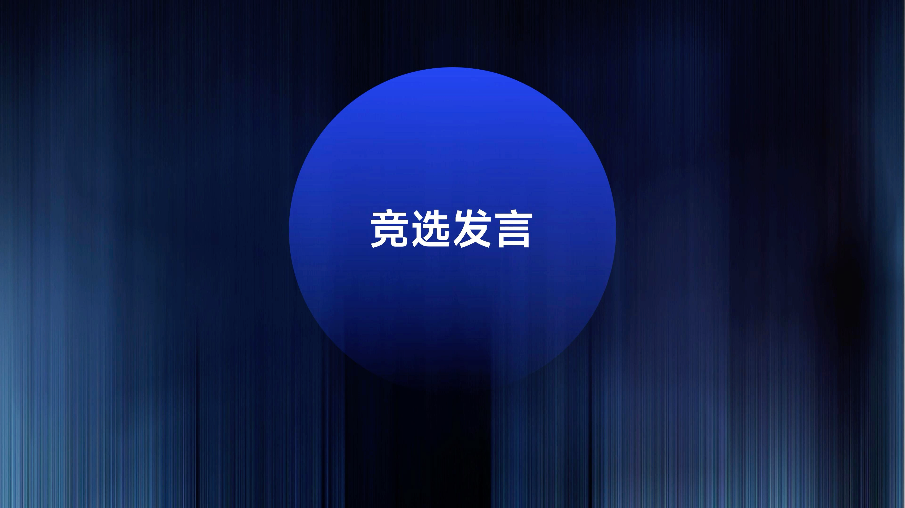
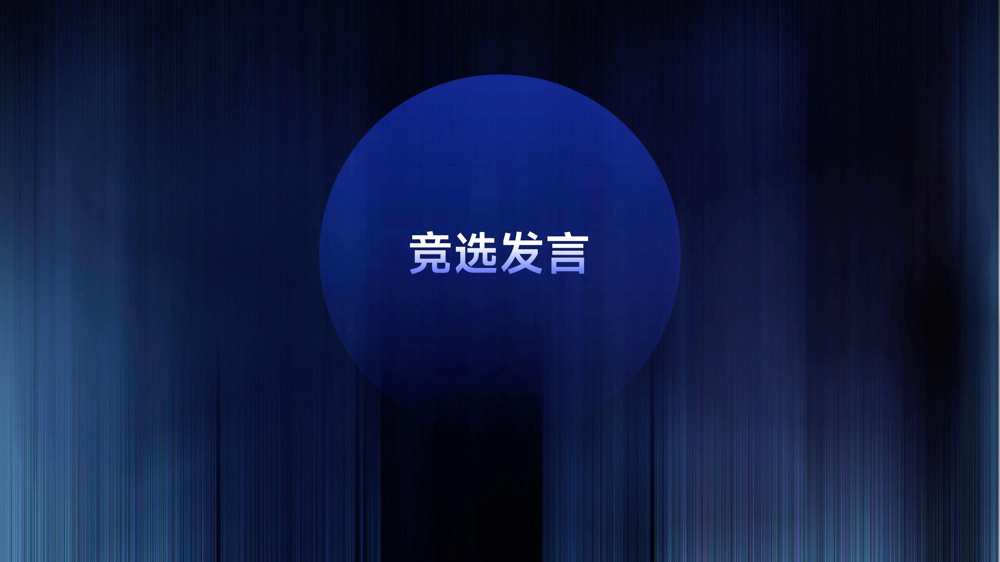

# V10 · 容器既要托住文字，也要融入背景

关键词：深色底板、融合、透明感、亮度、容器强度。

比较圆形承载面与周围深色环境：第一张上部更亮、块面更明显；第二张亮度更克制，背景纹理与圆形的关系更连续。文字都位于中央，但承载面的存在感不同。

哪个更合适取决于本页是否需要强烈聚焦。复杂背景可用更明确的面稳定文字；需要轻盈融合时可减弱边界、使用同色系渐变。仅把透明度调低可能同时损伤可读性。

提示词可写：“承载面与环境共享色相，局部亮度足以托住文字，边缘柔和融入背景。”主次仍需通过整页检查确认。

方法：[构图与排版](../handbook/layout.md)。
