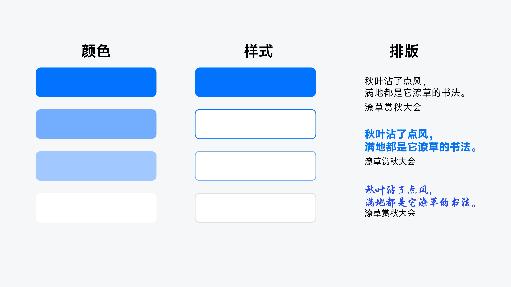

# V11 · 层级由多个视觉线索共同建立

关键词：信息层级、颜色、实心、描边、字重、重点。

左列用颜色深浅拉开强度；中列从实心面变成描边，视觉重量随之改变；右列比较文字全部近似和局部强化之后的阅读重点。

层级不只靠字号。面积、字重、位置、颜色、明暗和形状都能参与。几种线索共同指向同一重点，观众更容易理解；若每种线索各强调不同内容，页面会失去秩序。

提示词可写：“核心结论同时获得更大尺度与更强对比，支撑说明使用较轻字重，补充内容降一级；强调集中在同一逻辑重点。”文字气质取决于用途，图中的字形不是默认要求。

方法：[内容设计](../handbook/content.md)、[构图与排版](../handbook/layout.md)。
