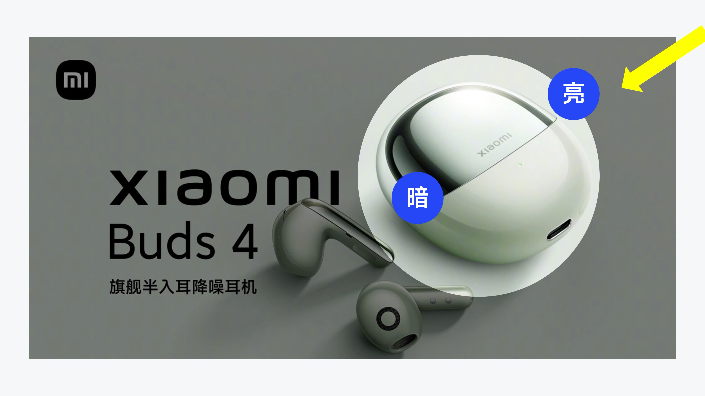

# V12 · 从亮暗面读出主光方向

关键词：光向、受光面、暗部、产品、立体感。

看箭头指向的右上区域和“亮”“暗”两个标注。主体的高光与背光区域给出了光线来源，即使场景中没有画出灯具，也应遵守同一光向。

产品进入新背景时，要让背景亮部、产品高光、阴影和反射可以被同一个空间解释。只加一道外发光无法代替真实受光关系。

提示词可写：“主光从右上方进入，产品右上受光、内凹与背光处较暗，地面投影方向与之协调。”实际方向应以当前素材为依据，不能固定为所有页面右上打光。

方法：[场景设计](../handbook/scene.md)。
