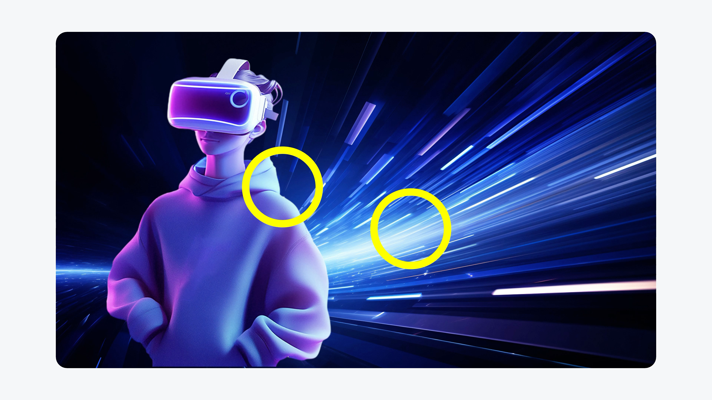
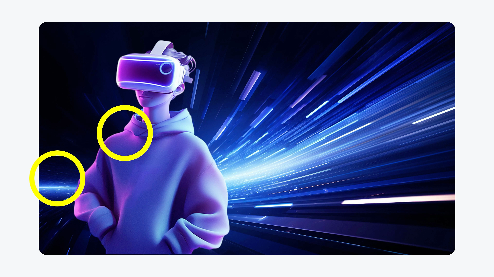

# V13 · 局部看似匹配，另一侧仍可能冲突

关键词：轮廓光、融图、色温、人物、拼贴感、环境光。

第一张的黄圈标出右肩青蓝高光与右侧青蓝亮区，二者能互相解释。第二张把注意力移到左肩的紫红色与左侧蓝色环境；画面里若没有合理的暖色或紫红补光，人物仍会显得来自另一张图。

这两张标注观察的是同一组合的不同部位，并不是完整的修改前后图。它说明只检查一处匹配不够，要看主体各侧的主要轮廓光和环境是否协调。

提示词可写：“统一人物与背景的主光色温，调整左侧不协调的紫红轮廓，右侧保留青蓝轮廓光。”也可以为左侧建立合理补光，但应服务当前场景。

方法：[场景设计](../handbook/scene.md)。
