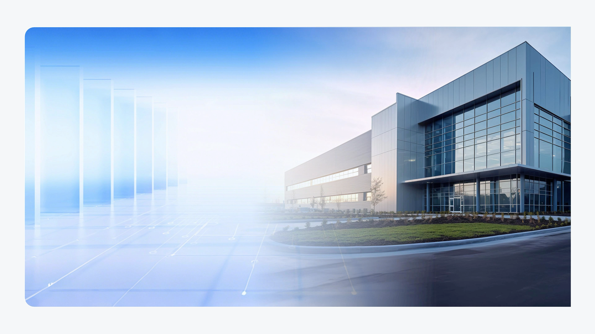
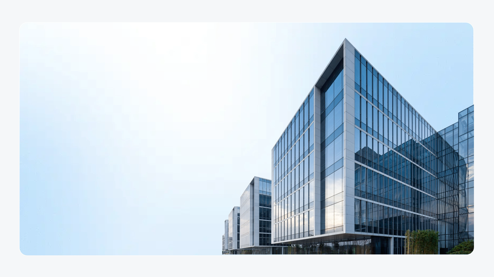

# V14 · 透视冲突不靠模糊边缘解决

关键词：透视、建筑、地平线、拼贴、背景取舍。

第一张左侧抽象室内空间、地面网格与右侧建筑照片各有自己的空间线索。虽然边缘已经柔化，观看者仍需要同时理解两个不易相容的空间。

第二张用更简单的天空与建筑组织画面，减少了竞争的透视线索。这里展示的是取舍方法：当真实素材不能自然进入复杂背景时，可以降低背景复杂度，或重新生成与素材视角一致的空间。

提示词可写：“以建筑照片的视角为依据，使用统一地平线和光向的简洁环境，避免引入另一个消失点明显不同的室内网格。”实际透视需看结构判断，不只检查颜色是否接近。

方法：[场景设计](../handbook/scene.md)、[素材选择](../handbook/assets.md)。
