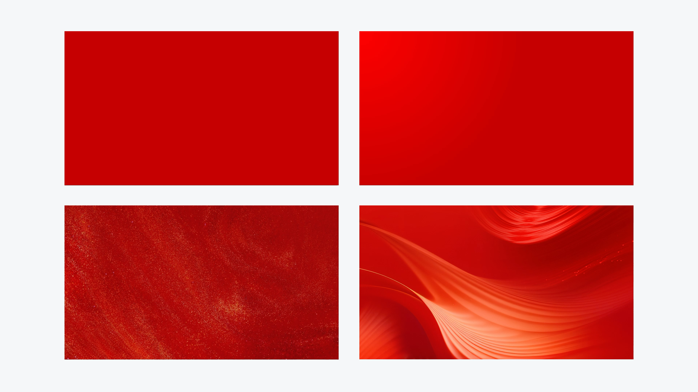

# V15 · 纹理使同一颜色呈现不同材质

关键词：纹理、材质、纯色、渐变、纸感、丝绸。

四个区域从平整色面到明暗过渡，再到细颗粒肌理和流动褶皱。主色相近，触感、空间感与情绪却明显不同。下右的波纹更有方向性，也更容易与正文竞争。

生成背景时应描述想要的材质与尺度，例如细密纸感、柔和丝绸、清透玻璃或低对比金属拉丝。只说“增加质感”不能确定应出现什么。

提示词可写：“保留红色主调，以低对比细纹提供触感，文字区纹理更安静，重点区域允许明显起伏。”纹理的存在需要支持主题和可读性。

方法：[场景设计](../handbook/scene.md)。
