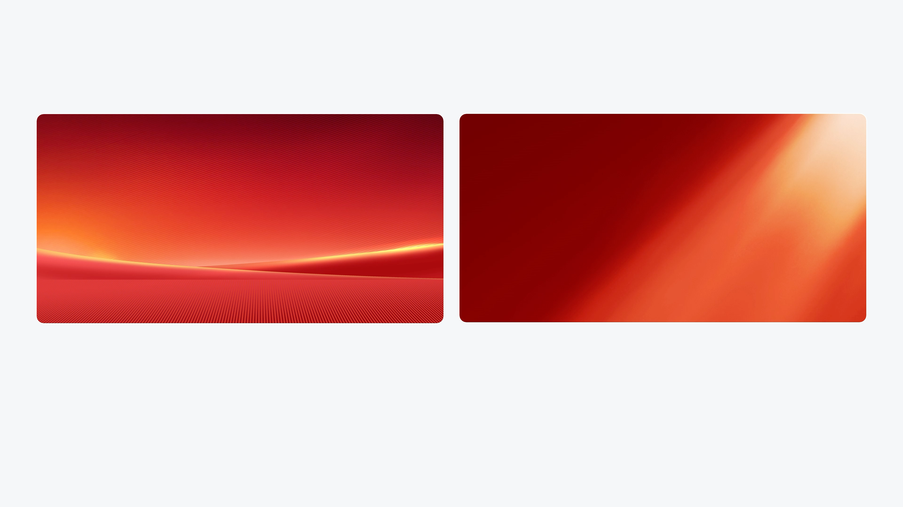

# V16 · 光的走向也是构图

关键词：光束、动势、方向、焦点、背景构图。

左图的低位水平亮带建立舞台和地平线，重心较稳定；右图从右上向左下展开的斜向光形成动势。两者主色相近，却适合不同的标题位置和主体姿态。

背景的光并非完成后才加的装饰。它会决定何处最亮、视线往哪里走、哪些区域容易承载文字。构思背景时就应结合本页阅读路径。

提示词可写：“低位水平光托起中央主体，上方标题区保持稳定”或“斜向柔光引导视线到核心结论，正文区降低光束强度”。根据页面意图选择，不叠加所有方向。

方法：[场景设计](../handbook/scene.md)。
