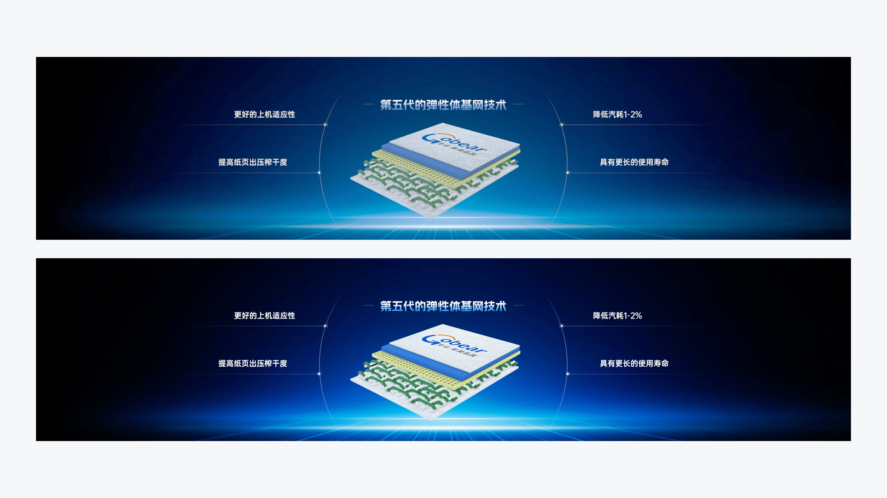

# V17 · 通透感需要明确的明暗层次

关键词：通透、灰蒙、对比、暗部、亮部、芯片。

比较上下两幅：下幅暗部更沉稳，底部光带和芯片亮面更鲜明，主体更容易从环境里分离出来。上幅整体更灰，亮暗层次的区分较弱。

“通透”不等于整张图一起提亮，也不等于物体必须透明。它常来自亮部、暗部、中间调有明确关系，主体和背景分得开，同时保留应有细节。

提示词可写：“加深环境暗部，保留清晰高光与中间调，让主体从背景中分离，暗部细节可辨。”如果实际主题需要柔和低反差，应按主题取舍，不能机械拉满对比度。

方法：[配色与文字](../handbook/color-type.md)、[场景设计](../handbook/scene.md)。
