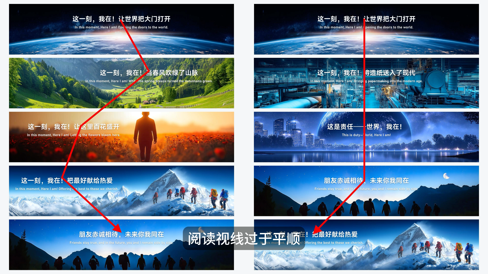

# V19 · 整套页面也有视线节奏

关键词：整套节奏、视觉动线、焦点变化、连续页面、居中。

看红色路径：左列的视觉重点随页面变化，形成折线；右列大多沿同一中轴，阅读位置更一致。它直观说明了连续页面如何形成不同节奏。

连续居中适合庄重、一致的段落，但整套长期只有同一种焦点位置可能单调。焦点变化应来自内容和素材变化，例如从整体场景转到人物，再转到关键证据。不能为了画出折线而随意移动标题。

提示词可写：“本页承接前一页中央大标题，以右侧主体和左侧结论改变重心，保持相同配色与字体气质。”整套总览时再判断变化是否自然。

方法：[叙事节奏](../handbook/rhythm.md)。
