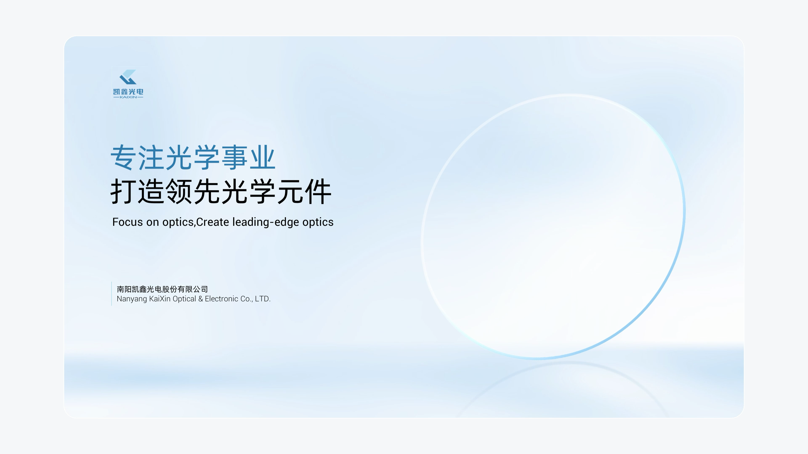

# V20 · 精致场景可以由少量关系构成

关键词：产品场景、玻璃、光学、精致、简洁、反射。

右侧透明镜片通过边缘亮度、薄厚感、地面反射和微妙光影变得可见。左侧标题与背景共享清浅色系，文字区域稳定。元素很少，但主体、地面和光有完整关系。

这张图解释的是精致感如何成立，不规定所有页面都要稀疏。用户偏好高填充度时，可以增加有意义的内容区，继续保持材质、光向和空间的一致。

提示词可写：“通过细腻边缘高光、可信厚度和轻微地面反射表现透明材质，背景明暗支持主体辨识，标题清晰稳定。”不要用大量无关装饰替代材质处理。

方法：[场景设计](../handbook/scene.md)。
